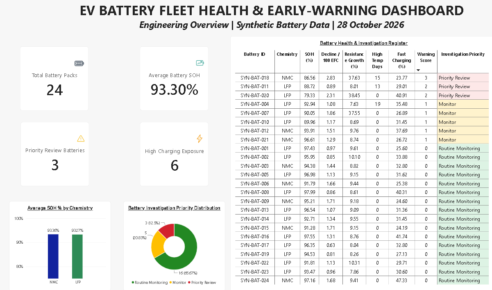
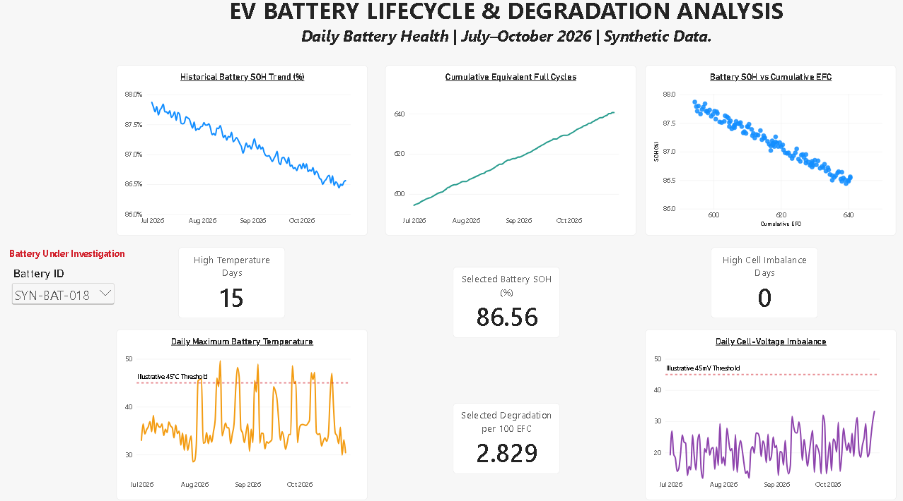
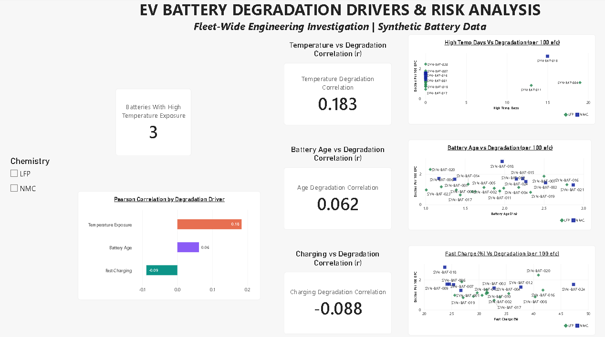

# EV Battery Health, Degradation & Lifecycle Analytics

**Independent, synthetic EV battery analytics case study | Excel • SQL Server • Power BI • Python**

> **Portfolio disclosure:** All 24 battery packs, sites, readings and charging records are fictional and were created for a learning scenario inspired by publicly described battery-swap analytics work. This is **not** MOCX, Rechaj or any employer's proprietary data, and no affiliation is claimed. Device thresholds are illustrative rather than manufacturer safety limits.

## Decision question

How could a light-electric-vehicle battery-swap operator use operational telemetry to identify packs needing review, understand degradation patterns and communicate evidence-based follow-up priorities?

## Dataset

- **24 packs:** 16 LFP, 8 NMC; four fictional operating locations.
- **2,880** daily readings (24 × 120 days), from 1 July through 28 October 2026.
- **3,024** charging events, including **961 fast-charge sessions** (31.78%).
- Capacity, resistance and thermal signals are synthetic estimates—not verified field or laboratory diagnostics.

## Headline results

| Indicator | Verified result |
|---|---:|
| Fleet average latest capacity SOH | **93.30%** |
| Packs with latest SOH below 90% | **4** |
| Priority Review (2+ illustrative flags) | **3** |
| Monitor (1 flag) | **5** |
| Routine Monitoring (0 flags) | **16** |
| High fast-charging exposure (top quartile) | **6** |
| Mean SOH decline / 100 observed EFC, LFP | **1.147 pp** |
| Mean SOH decline / 100 observed EFC, NMC | **1.728 pp** |

## Priority findings and proposed checks

| Pack | Observed signal | Proposed investigation (not a confirmed diagnosis) |
|---|---|---|
| **SYN-BAT-018** (NMC) | Latest SOH **86.56%**, **15** high-temperature days, resistance growth **37.63%**, decline **2.829 pp/100 EFC** | Verify sensor/calibration quality, cooling and thermal exposure history, operating load/cycling, and resistance trend |
| **SYN-BAT-020** (LFP) | Latest SOH **79.33%**, resistance growth **38.45%**, fast-session share **40.91%** | Confirm capacity estimate with an approved test, inspect electrical connections/resistance trend, review charging history |
| **SYN-BAT-011** (LFP) | Latest SOH **88.72%**, **13** high-temperature days | Check thermal-management performance, site conditions and sustained exposure patterns |
| **SYN-BAT-012** (NMC) | **38** high-cell-voltage-spread days, latest delta **47.2 mV** | Review cell-voltage measurement, balancing behaviour, cell grouping and historical trends |
| **SYN-BAT-021** (NMC) | **37** high-imbalance days, latest delta **52.6 mV** | Review balancing and cell spread alongside age and operational usage |

The first three packs have Priority Review classification. BAT-012 and BAT-021 have Monitor classification under the illustrative latest-snapshot score; their repeated voltage-spread events still merit focused follow-up.

## Statistical validation | Why caution matters

The **NMC high-temperature-days / cycling-adjusted degradation** Pearson correlation was **r = +0.947** across eight NMC packs. However, **BAT-018 was the only NMC pack with any >=45°C days**. Excluding BAT-018 leaves a constant temperature predictor and an **undefined** correlation.

The standard Pearson p-value is approximately **0.00035**, but an exact conditional exercise that reassigns the single exposure among eight NMC packs gives a **two-sided permutation p-value of 0.125**. These calculations do not establish causality, fleet-wide risk or predictive failure probability.

Additional Python chemistry-correlation and BAT-018 sensitivity charts are in the locally prepared portfolio pack; those specific PNGs have not yet been committed to `figures/`.

## Power BI dashboard gallery

The three screenshots below show the Power BI report pages built from **synthetic** battery datasets. Click an image to see it at full size. The [Power BI Desktop report file](powerbi/EV_Battery_Health_Degradation_Analytics.pbix) is also available for download and local inspection in Power BI Desktop; this repository does not host a live interactive report.

### Page 1 — Fleet Health & Early Warning



**Fleet overview:** 24 batteries, mean latest SOH 93.30%, 3 Priority Review packs, and an investigation register.

### Page 2 — Battery Lifecycle & Degradation



**Selected battery: SYN-BAT-018.** Latest SOH 86.56%, cycling-adjusted decline 2.829 pp/100 EFC, 15 days at or above the illustrative 45°C threshold, and no days at or above the illustrative 45 mV imbalance threshold.

### Page 3 — Degradation Drivers & Risk Analysis



**Full-fleet correlations:** high-temperature days r = +0.183, age r = +0.062, and fast-charging share r = −0.088. These exploratory linear correlations do not establish causation.

## Engineering report

[**Download EV Battery Engineering Case Study (Word)**](reports/EV_Battery_Engineering_Case_Study.docx) — six-page narrative report to accompany the Power BI dashboards. All findings use synthetic teaching data.

## Excel analysis workbook

[**Download EV Battery Day 1 Workbook (.xlsx)**](excel/EV_Battery_Day1_Workbook.xlsx) — supporting Excel workbook for initial battery data exploration and KPI exercises. The synthetic raw datasets are maintained separately in [`data/`](data/).

## Jupyter analysis notebook

[**Open completed EV Battery Health & Degradation Jupyter Notebook (.ipynb)**](notebooks/EV_Battery_Health_Degradation_Analysis.ipynb) — the author's working notebook, uploaded alongside the standalone [Python validation script](analysis/run_analysis.py). The file has been verified in GitHub, but has not been independently re-executed from this repository.

## Technical workflow

1. **Excel** — data familiarisation, basic quality checks and KPI exercises.
2. **SQL Server** — relational ingestion, battery diagnostics, latest-observation selection, early-warning indicators and integrated analysis views (developed in the working project).
3. **Power BI** — three completed working dashboard pages: Fleet Health, Battery Lifecycle & Degradation, and Degradation Drivers & Risk Analysis.
4. **Python** — independent dataset reconstruction, group summaries, correlations, permutation and leave-one-out sensitivity tests.

### Reproduce core calculations

From the repository root, install compatible packages in your chosen environment and run:

```bash
python -m pip install pandas numpy scipy matplotlib
python analysis/run_analysis.py
```

The script reads `data/*.csv` and regenerates analytical tables and a summary JSON in `analysis/`. The three Power BI dashboard screenshots are published above. Additional Python figures have not yet been uploaded; the [author's Jupyter notebook](notebooks/EV_Battery_Health_Degradation_Analysis.ipynb) is now in GitHub, though execution has not been independently retested.

## Repository structure

```text
EV_Battery_Analytics/
├── README.md
├── requirements.txt
├── PORTFOLIO_PUBLISHING_CHECKLIST.md
├── data/
│   ├── battery_master.csv
│   ├── daily_telemetry.csv
│   ├── charge_events.csv
│   └── DATA_DICTIONARY.md
├── analysis/
│   └── run_analysis.py
├── notebooks/
│   ├── README.md
│   └── EV_Battery_Health_Degradation_Analysis.ipynb
├── excel/
│   ├── README.md
│   └── EV_Battery_Day1_Workbook.xlsx
├── sql/
│   └── Day1_SQL_Server_Exercises.sql
├── reports/
│   ├── README.md
│   └── EV_Battery_Engineering_Case_Study.docx
└── powerbi/
    ├── README.md
    ├── EV_Battery_Health_Degradation_Analytics.pbix
    ├── Fleet_Health_Dashboard.png
    ├── Battery_Lifecycle_Dashboard.png
    └── Degradation_Drivers_Dashboard.png
```

## Outstanding local files to upload

All **three approved Power BI screenshots and the editable `.pbix` file have been uploaded** under `powerbi/`. The PBIX is a downloadable Power BI Desktop artifact, not a live hosted interactive dashboard. The uploaded PBIX has been verified as a file in GitHub, but has not been opened or tested through this connection. The starter SQL exercises are in `sql/`; the later SSMS view definitions have not yet been uploaded. The **engineering case-study report is available** in [`reports/`](reports/EV_Battery_Engineering_Case_Study.docx); the **Excel workbook is available** in [`excel/`](excel/EV_Battery_Day1_Workbook.xlsx); the [Jupyter notebook](notebooks/EV_Battery_Health_Degradation_Analysis.ipynb) is published. The final SQL Server views and additional standalone Python figures are still pending.

## Boundaries and limitations

This synthetic learning project is illustrative, not a battery-failure or warranty evaluation. Capacity SOH is computed from modelled BMS estimates; no reference capacity test, uncertainty interval, verified device operating limits or battery RUL model is provided. Chemistry cohorts differ in size and age; observational comparisons are not causal. Priority scores are screening aids, not formal risk ratings.

## Deliverable

Download the [six-page Engineering Case Study (Word)](reports/EV_Battery_Engineering_Case_Study.docx) for the management summary, engineering evidence, findings and proposed follow-up actions. The report is based on synthetic data. See [Portfolio Publishing Checklist](PORTFOLIO_PUBLISHING_CHECKLIST.md) for the remaining assets.